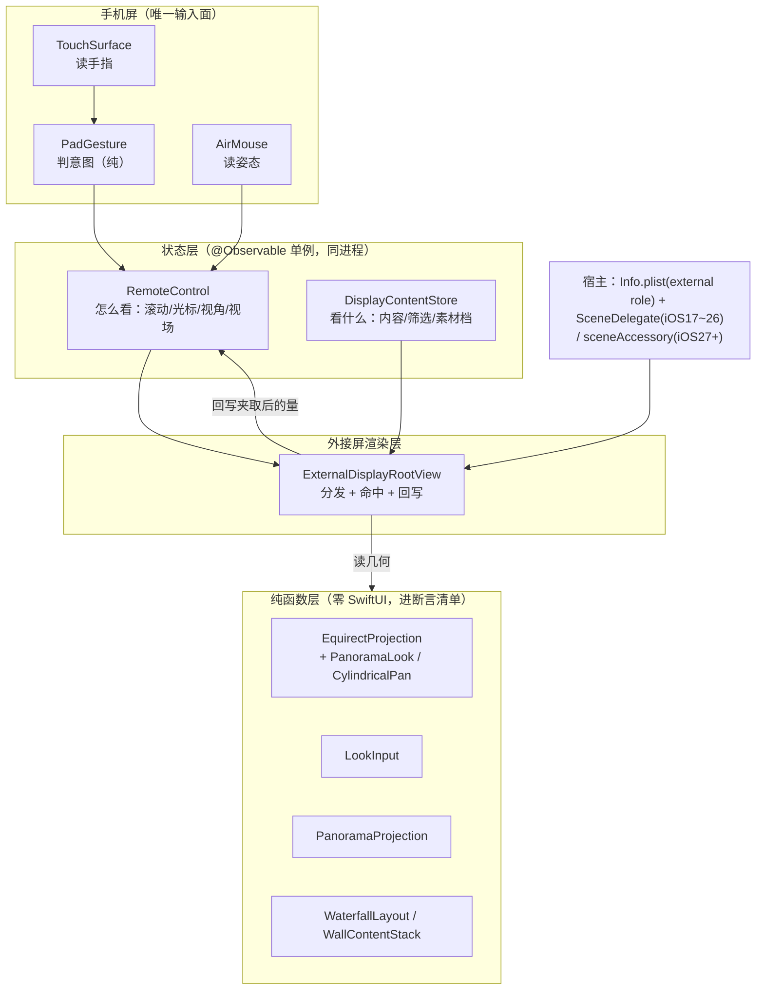
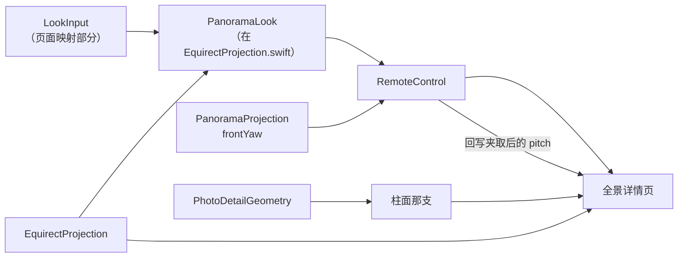

# 全景浏览方案 —— 实现总结与移植到 jove-view

> 源工程 `ExternaldisplayDemo`（本仓），目标工程 `jove-view`。
> 结论状态：源侧**全景线已无未完成的票**，683 条纯函数断言全绿（2026-09-28）。
> 目标侧**尚未动工**；本文第 4.1 节是导出清单，第 6 节是移植路线。

---

## 1. 要解决的问题

在**非交互外接屏**（`windowExternalDisplayNonInteractive`，即眼镜屏）上浏览全景照片。三个约束把这
个问题定死了：

| # | 约束 | 后果 |
|---|---|---|
| C1 | 外接屏**收不到任何触摸**（系统不投递） | 所有输入必须在手机屏采集，再中继到外接屏渲染视图 |
| C2 | 「全景」不是一个东西，是**两类** | equirect（360°，固定 2:1）与柱面（iPhone 全景，1:3~1:5）的像素排布不同 ⇒ 几何必须分档 |
| C3 | IMU 只给**相对量**，且会漂移 | 覆盖 360° 只能靠增量累积；必须提供「归零」纠偏入口 |

用户对该交互的目标模型（原话）是**「坐在转椅上转一圈」**：

> 屏幕是**窗口**，窗口中心对着的方向就是你的朝向；转手机 = 窗口同向滑动，
> 物理转角与窗口位移角 **1:1**；转满 360° 看完整图。

拆成四条不变量：R1 是窗口（看一段连续经度区间）／R2 窗口**中心** = 当前朝向／R3 1:1 增益／
R4 转手机方向 = 窗口移动方向。**这四条是整套方案的判据**，后面所有设计都在服务它们。

---

## 2. 分层架构



**一句话分工**：`RemoteControl` 管「怎么看」，`DisplayContentStore` 管「看什么」，
纯函数层管「怎么算」，渲染层管「怎么画 + 命中判据」。

### 2.1 职责表

| 层 | 文件 | 职责 | 关键纪律 |
|---|---|---|---|
| 纯函数 | `EquirectProjection.swift` | 球面投影几何 + `PanoramaLook` + `CylindricalPan` | 所有量**现算**不存，避免 `look/fov/viewport` 三者不一致 |
| 纯函数 | `LookInput.swift` | 拖动增量 → 视角增量；姿态 → 读数 | 符号是这条链唯一靠**推导**而非试错的东西，三支都写明依据 |
| 纯函数 | `PanoramaProjection.swift` | 投影档位 + `frontYaw` + 筛选 | 分档，不混做一套几何 |
| 状态 | `RemoteControl.swift` | 视口状态汇聚点，按页分流 | 存**归一化**值，不存像素（外接屏尺寸未知） |
| 状态 | `DisplayContentStore.swift` | 内容集合与纹理档 | 切筛选不碰任何视口状态 |
| 输入 | `AirMouse.swift` | 姿态 → 指针 / 视角 | 一份姿态**物理互斥**，按页分流 |
| 渲染 | `ExternalDisplayRootView.swift` | 排版、命中、回写 | 命中由它算，回写模型（唯一反向写入） |
| 宿主 | `ExternalDisplayAccessory.swift` 等 | scene 接入（两套并存） | 见 §6.1 |

---

## 3. 九条核心不变量

这一节是**最该带走的部分** —— 它们是踩出来的，每一条背后都有一次具体的翻车。

| # | 不变量 | 为什么（症状） |
|---|---|---|
| I1 | **`yaw` 的口径是「朝向」= 视口正中那条经线** | 旧口径是「屏幕左边缘 = yaw」，与柱面那支（中心 = yaw）**对同一份 `yaw` 给出两种含义**。症状：静态截图上只像「内容偏了半个窗」，真机手感是「转半天才看到想看的」 |
| I2 | **横向走增量累积，纵向走绝对映射，走的是「最短弧」** | `CMAttitude` 的 Tait-Bryan 角归一化在 `(−π, π]` ⇒ 直接当视角用最多转 ±180°。绝对映射的 pitch 才有「松手回正」的手感 |
| I3 | **横向有两条来源：`yaw` 与 `roll`，相加** | 「左右倾手机」落的是 `roll` 不是 `yaw`。只读 yaw 的症状是「上下很灵、左右几乎没反应」，**看起来像灵敏度不够，实际是整支映射没接**（先问分量，别先调 gain） |
| I4 | **增益 1:1**（`gain = 1`） | 物理转角 = 窗口位移角。这是 R3，转椅模型成立的前提 |
| I5 | **接缝处必须补第二份贴图**（`tileCount = 2`） | 一份贴图铺不满一圈；不补，转到接缝露空白 |
| I6 | **视场是档位不是滑杆**（60/90/120），且外部输入要**折到最近档** | 分段控件没有对应段可点亮会渲染成空白 |
| I7 | **pitch 的权威在渲染侧**，Core 只做 ±90 护栏；渲染每帧夹取后**回写**，夹取必须**幂等** | 不幂等会形成「每帧改一点」的更新循环 |
| I8 | **页内两个输入源必须同向，页间允许不同向** | 拖动与空鼠在**同一页**反向 ⇒ 「它有时候是反的」。但全景页（转身）刻意与幕墙（推板）反向 |
| I9 | **「正前方」由投影档决定**（equirect 180°／柱面 0°） | 退回同一个常数会让 equirect 打开就正对 0° 经线 —— 那是贴图**接缝**，最不该当默认 |

### 3.1 为什么 I1 是本方案最值钱的一条

它是唯一一条**改了口径却不报错、且静态截图看不出错**的。落地手段是把它变成**可断言的量**：

```swift
var facingLongitude: CGFloat { longitude(atScreenX: viewport.width / 2) }
// 正解下：facing == yaw
// 旧口径下：facing == yaw + fov/2  ← 必然红
```

于是「改口径」从「对着截图看像不像」变成一条**能先红后绿**的断言（改前 24 条红，改后全绿）。
**这条方法论比这条不变量本身更值得带走**：任何口径类改动，先造一个可计算的量，再动代码。

---

## 4. 纯函数层 = 可移植内核

可移植性的判据是**零 SwiftUI 依赖**，具体体现为「能进那条 `swiftc` 命令」。那份命令行本身就是
「哪些文件是纯的」清单（见 `.scratch/verify/main.swift` 头部注释）：

```
WaterfallLayout / WaterfallFocus / DisplayScrollGeometry / LateralGeometry /
BackButtonGeometry / StarfieldModel / PhotoDetailGeometry / PanoramaProjection /
EquirectProjection / PanoramaAssetCatalog / WallContentStack / PanoramaStripGeometry /
LookInput / PadGesture / TapSequence
```

**这两点值得立刻带走：**

1. **纯函数层是零依赖的** —— 只 import `CoreGraphics` / `Foundation`。搬到任何工程都不需要改一行。
2. **「能进清单」是个可执行的判据** —— 不是「这个文件看起来挺纯」，而是「它编译得过那条命令」。
   引入 SwiftUI 依赖会立刻编译失败，没法蒙混。

其中**全景这条线真正需要的内核只有 5 个文件**：

| 文件 | 行数 | 内容 |
|---|---|---|
| `EquirectProjection.swift` | 385 | `PanoramaLook`（视角累积）+ `EquirectProjection`（球面几何）+ `CylindricalPan` |
| `LookInput.swift` | 142 | `AttitudeReading` + 拖动/姿态 → 视角的符号推导 |
| `PanoramaProjection.swift` | 107 | 投影档位 + `frontYaw` + `PanoramaFilter` |
| `PhotoDetailGeometry.swift` | 143 | 柱面那支复用它（`.fill` + 可左右拖） |
| `PanoramaStripGeometry.swift` | 161 | 素材条带的命中几何（若要素材选择入口） |

### 4.1 全景线的完整文件清单（导出用）

按"搬过去要做什么"分四类。**只有第一类是零改动直搬**，其余都要接进目标侧的对象。

| # | 文件 | 层 | 搬过去要做什么 |
|---|---|---|---|
| 1 | `ExternalDisplay/EquirectProjection.swift` | 纯 | **直搬**。`PanoramaLook.advanced(deltaYaw:deltaPitch:)` 正好供速率式用 |
| 2 | `ExternalDisplay/PanoramaProjection.swift` | 纯 | **直搬**（`frontYaw` 是 I9 的落点） |
| 3 | `Core/LookInput.swift` | 纯 | **拆开**：`yawDelta` / `pitchDelta` 直搬；`AttitudeReading` / `reading(...)` 只在姿态式下需要 |
| 4 | `ExternalDisplay/PanoramaAssetCatalog.swift` | 纯 | **改接法**：`PanoramaAssetSource`（四档帧源）直搬；文件清单换成读 `PHAsset` |
| 5 | `ExternalDisplay/PanoramaStripGeometry.swift` | 纯 | 视需求（素材条） |
| 6 | `ExternalDisplay/PhotoDetailGeometry.swift` | 纯 | 目标侧**已有** |
| 7 | `ExternalDisplay/EquirectSourceCanvas.swift` | 渲染 | **直搬**（零依赖，纯 `Canvas`）。它同时是 `.animated` 那一档的底 |
| 8 | `ExternalDisplay/PanoramaDetailView.swift` | 渲染 | **参照改写**接进目标侧的详情页宿主 |
| 9 | `ExternalDisplay/PanoramaImageStore.swift` | 渲染 | **改接法**：换图源 + 目标侧可能已有缓存层 |
| 10 | `App/PanoramaFOVPicker.swift` | 手机 UI | **直搬**（纯 SwiftUI 分段控件） |
| 11 | `Core/RemoteControl.swift` | 状态 | **改现有**：加 `panoramaLook` / `panoramaFOV` / `frontLook` / `advanceLook` / `clampLookPitch` + 按页分流 |
| 12 | `Core/DisplayContentStore.swift` | 状态 | **改现有**：加 `panoramaSource`（帧源档）/ `panoramaPhase` / `filter` |
| 13 | `Core/AirMouse.swift` | 输入 | **不搬**：目标侧用 `PointerController` + `MotionSource`（见 §6.2） |
| 14 | `Debug/MockPanoramaAsset.swift`、`Debug/MockRemoteState.swift` 的 `pano/look/fov/phase` 键 | 调试 | **参照搬**，断言与截图要靠它 |
| 15 | `Scripts/fetch-panorama-assets.sh`、`Scripts/extract-panorama-frame.swift` | 工具 | **视需求**（目标侧素材来自相册时不需要） |
| 16 | `.scratch/verify/main.swift` §15–§22 | 验证 | 断言**重写进目标侧的测试套件**，不搬脚本本身 |
| 17 | `.scratch/tools/{bbox,pixdiff,seam}` | 工具 | **可直搬**（纯命令行，与工程无关） |

**分层依赖是单向的**：纯函数层 ← 状态层 ← 渲染层／UI。所以 1–6 可以先整体搬过去，
在目标侧跑通断言，再逐层往上接 —— 中间任何一层出问题都不会污染下面那层。

⚠️ **`.scratch/` 里的脚本与工具都不进 App**，但 16、17 两类是"这次能把结论量出来"
的全部依据，**导出时不要漏**（它们不在 Xcode 的编译集里，容易被当成临时文件丢掉）。

---

## 5. 可验证性设计

`simctl` **没有触摸注入 API** —— 这决定了整个工程的验证策略：把「手指按下 → 出什么动作」
抽成纯结构体喂事件断言，剩下驱动不了的靠**预置状态 + 截图**。

| 手段 | 覆盖 | 位置 |
|---|---|---|
| 纯函数断言（667 条） | 状态 → 布局/投影/符号 | `.scratch/verify/main.swift` |
| 启动参数预置状态 | 让目标状态**开机就在**，可与基线逐像素比对 | `MockRemoteState`（`pano=` `look=` `fov=` `detail=`） |
| 截图核对 | 外接屏真实像素 | `-mockExternalDisplay` 替身窗口 + `simctl io screenshot` |
| 包围盒定位 | 替身窗口位置随遥控台高度漂移，必须每次重量 | `.scratch/tools/bbox` |
| 逐像素比较 | 判「改动真的改了像素吗」 | `.scratch/tools/pixdiff --boxes` |
| **接缝定位** | 把"摆位一致"从"看着像"变成**一列数** | `.scratch/tools/seam` |

**三条硬纪律：**

- **比像素一定要带对照组** —— 否则工具坏了、永远输出 0，看起来也是「完全一致」。
- **幕墙页不能拿整窗做基线**（hero 是帧驱动动画，两次运行必然不同）；比幕墙只能比
  「素材条带 + 瀑布流带」并 `--exclude` hero。
- **要排除的区域得从图上量，不能按窗口公式猜**。票 `05` 里按公式算的 HUD 时钟排除区
  比实际窄了 160 px，残余被算进"差异像素"里，于是得出"动画没生效"的**假结论**。
  先比一次同构建连拍量出噪声底，才知道哪一块是每帧都在动的。

---

## 6. 移植到 jove-view

### 6.1 jove-view 现状盘点（重要）

**目标侧的家底比预期厚** —— 外接屏这条链**已经移植过了**，缺的是**全景那半条**。

| 能力 | jove-view 现状 | 处置 |
|---|---|---|
| scene 接入（两条路径并存） | ✅ `JoveSceneAccessory` / `JoveExternalSceneDelegate` / `Info.plist` | **不动** |
| 屏状态中心 | ✅ `JoveExternalDisplayMonitor` | **不动** |
| 无硬件替身 | ✅ `JoveMockExternalDisplay` / `MockExternalDisplayPlan` | **不动** |
| 指针 / IMU 输入 | ✅ `PointerController` + `CoreMotionSource` + `PointerMapper` | **改**（见 §6.2） |
| 手势状态机 | ✅ `PadGesture` / `TapSequence` / `SurfaceGestureRouting` | 复用 |
| 遥控状态 | ✅ `RemoteControl`（已有 `GlassesScrollPage` 分页 grid/wall） | **改**（加全景页与视角量） |
| 详情几何 | ✅ `PhotoDetailGeometry` | 复用（柱面那支直接吃） |
| 测试体系 | ✅ `joveviewTests/`（70 个 XCTest 文件） | 断言落这里，**不搬 demo 的 swiftc 脚本** |
| Glasses UI | ✅ `Glasses*` 一整套（album / media detail / chrome / hud / focus） | 复用宿主，新增全景页 |
| **全景几何** | ❌ 无 | **新增**（§6.3） |
| **视角输入链** | ❌ 无 | **新增**（§6.2） |
| **瀑布流** | ❌ 无 | 视需求（§6.3） |

### 6.2 头号差异：IMU 模型不同（**必须先拍板**）

这是整个移植里**唯一需要重新设计**的地方，其余都是搬运。

| | demo（源） | jove-view（目标） |
|---|---|---|
| 数据源 | `CMAttitude`（**绝对姿态**）+ `multiply(byInverseOf:)` 取相对 | `CMDeviceMotion.rotationRate`（**角速度**）+ `gravity` |
| 表示 | 三个 Tait-Bryan 角（度）：yaw / pitch / roll | `MotionSample.rate`（SIMD3, rad/s）+ `gravity` |
| 主轴解析 | 无（直接读角度分量） | `PointerMapper.worldRate` 把角速度投影到**两个**轴：绕重力轴（`horizontal`）、绕屏幕 x 轴（`vertical`） |
| 积分 | `shortestArc` 折最短弧后**逐帧累加** | 直接 `rate × dt` 累加 |
| ±180° 回绕 | **必须处理**（`shortestArc` + `wrap` 是本链最易错处） | **天然不存在** |
| 漂移 | 有（攒量化误差）⇒ 需要 `recenter` | 有（陀螺仪 bias）⇒ 同样需要 `recenter` |

**结论（三条）：**

1. **不要照搬 `AttitudeReading` / `shortestArc` / `wrap` 那套。** 它们存在的唯一理由是
   Tait-Bryan 角的 ±180° 回绕；速率式积分**没有这个问题**，搬过去是凭空多一份要同步的复杂度。
2. **横向应复用 `PointerMapper.worldRate` 的 `horizontal` 分量积分成 yaw**，垂直用 `vertical`
   积分成 pitch。增益直接给 1:1（`yaw += horizontal × dt`），与 I4 一致。
3. ⚠️ **但速率式只有两个投影轴，没有 `roll` 这一支。** `horizontal = dot(rate, up)`
   度量的是「绕重力轴的转动」（罗盘式转身）；而 demo 票 08 的教训是**用户实际的「左右动手机」
   手势有可能落在 roll（绕机身长轴 / 屏法线的倾转）**，那种转动与重力轴垂直，
   `horizontal` 读出来接近 0。
   ⇒ **若真机判读发现用户的左右手势落在倾转上，速率式这条路会缺一个通道**，
   需要补第三个投影轴（绕屏法线方向的分量），而不是「照搬 demo 的 roll」。
   **这一点必须在 jove-view 真机上先判读，再定实现** —— demo 侧同一个问题也仍未判读
   （页脚摆出三个原始读数就是为这一步准备的）。

   判读手段：在 jove-view 里把 `rate` 三个分量与两个投影轴**一起打到控制台**，让用户做
   「左右动手机」这个动作，看能量落在哪个通道。这一步不做，写出来的映射有一半概率是错的，
   而且**错得很安静**。

### 6.3 全景之外的附带项

**全景线自己的逐文件处置表在 §4.1**（那里也标了每一条"搬过去要做什么"）。
这里只列会被顺手带出来的东西 —— 它们与全景**正交**，各自是个独立决策：

| 源文件 | 处置 | 说明 |
|---|---|---|
| `ExternalDisplayRootView.swift` | **参照改写** | 全景页排版、命中、回写那三段参照它；jove-view 的宿主是 `GlassesMediaDetailView` 那一系 |
| 瀑布流（`WaterfallLayout` / `WaterfallColumnView` / `WaterfallFocus` / `WallContentStack`） | **视需求** | jove-view 已有 `GlassesAlbumGridScroll` / `GlassesAlbumsView` 一套网格，**换不换成瀑布流是产品决策**，不是技术必需 |
| `StarfieldModel` / `StarfieldBackdrop` / `LateralGeometry` | **视需求** | 幕墙那套与全景正交 |
| `PadGesture` / `TapSequence` | 目标侧已存在 | 复用 |

### 6.4 分期路线建议

| 阶段 | 内容 | 产出判据 |
|---|---|---|
| **P0 · 判读** | 真机上把 `rate` 三分量与两个投影轴打到控制台，让用户做「左右动手机」 | 确定用户手势落在哪个通道 ⇒ 定 A 或 B 方案（§6.2 第 3 条） |
| **P1 · 内核** | 搬 `EquirectProjection` / `PanoramaProjection` / `LookInput` 的页面映射部分 | XCTest 断言 `facingLongitude == yaw`、`fovStops`、拖动符号，**先红后绿** |
| **P2 · 接线** | `RemoteControl` 加视角量 + 页面分流；`PointerController` 加「喂视角」模式 | 单测覆盖分流（哪一页改哪个量） |
| **P3 · 渲染** | 全景详情页 + 素材入口 + FOV 选择器 | 截图核对：三档 fov 恰好卡边缘、`yaw 180°` 标签居中 |
| **P4 · 收尾** | 归零入口、页脚读数、退出路径 | 验「全景页里指针还在动吗」（设 I 的闲置手势风险） |

### 6.5 移植时必须一并带走的「负资产警告」

- **全景页里指针会被清掉**（姿态与指针物理互斥）⇒ 任何靠指针命中的入口（含返回按钮）
  在全景页**全部不可达**。必须另开一个不依赖指针的出口（常驻按钮 / 或一个在该页确实无含义的
  闲置手势）。移植时**先问：这一页里指针还在动吗？**
- **进页面朝向依赖一张注入的表**（`id → 投影档`）。若预置/测试代码跑在注入之前，读表拿到空
  ⇒ 回落默认值 ⇒ 症状是「改动像没生效」。**凡「决定初始值」的函数读注入表，都要确保读之前表已注入。**
- **夹取幂等**：渲染侧每帧夹 pitch 后回写，夹取不幂等会形成逐帧更新循环。
- **换页要重置视角**：新照片的 0° 与旧的 0° 不是同一个方向。这条有可观测后果 ——
  启动参数里 `look=` 必须排在 `pano=`/`detail=` **之后**。

---

## 7. 已知盲区与待决（源侧）

| # | 项 | 状态 |
|---|---|---|
| B1 | 真机 IMU 符号（往左倾是看左还是看右） | **未判读**（无适配器 + 无真机陀螺仪数据） |
| B2 | 纵向拖动隐喻（转身 vs 抓图） | 已按「转身」实现，**若保留抓图去掉一处符号即可**，待拍板 |
| B3 | 幕墙页 33px 像素差 | 未深挖（改动在幕墙页一行都不执行；票 07→08 间也有同类 43px） |
| B4 | iOS 17~26 路径 | **无法本机实测**（只有 iOS 27 模拟器运行时），涉及它的结论一律未验证 |
| B5 | 真机 + HDMI 适配器外接屏 | **从未实测**（无适配器）。模拟器替代不了（`UIScreen.screens.count == 1`） |
| B6 | ~~球面 × 逐帧纹理~~ | ✅ **已完成**（票 `05`，2026-09-28） |
| B7 | **实时取帧**（解码器帧回调 → 纹理上传） | 源侧**无解**：demo 没有视频管线。本线验的是"帧源与几何解耦"这条几何性质，时序那一层留给真实工程。**目标侧有地基**：jove-view 走 `AVAssetReader` 逐帧解码 → `CVPixelBuffer`（`ImageConversion` 已开 Metal 兼容），不需要 `AVPlayerItemVideoOutput`；要解的是"线性解码 ↔ 可 seek/暂停/循环"的帧供给对齐 |

---

## 附：全景线的最小依赖图



**最小可移植集 = `EquirectProjection.swift` + `PanoramaProjection.swift` + `LookInput` 的页面映射部分
+ `PhotoDetailGeometry.swift`（已有）**，共约 600 行零依赖代码。其余都是接法与 UI。
